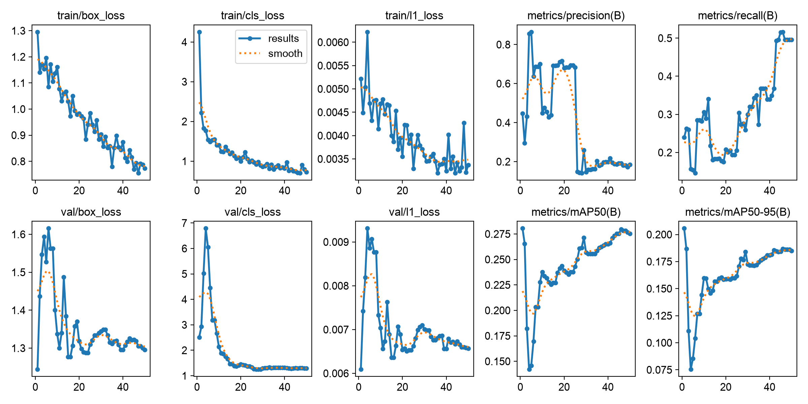
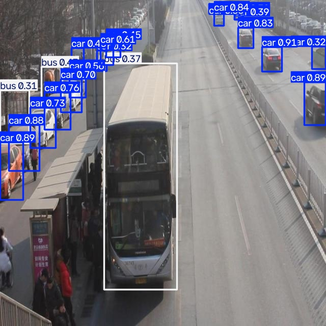

# Báo cáo cá nhân — Ngày 2 Object Detection

## 1. Thông tin học viên

- **Họ tên** Nguyễn Công Quý
- **MSSV** 2A202603149
- **Lớp** K5 Level 2
- **Môi trường chạy** macOS trên Apple M4 Pro, dùng MPS. Bằng chứng chạy local nằm ở mục 5.
- [Repo bài làm](https://github.com/nguyencongquy/K5-L2-Day02-NguyenCongQuy-2A202603149-ObjectDetection)

## 2. Schema và mini guideline

Schema giữ nguyên `0=car`, `1=truck`, `2=bus`, `3=van`. Mỗi xe có một box ôm sát phần nhìn thấy. Với xe bị cắt khung, box dừng ở mép ảnh. [Mini guideline](../../GUIDELINE_MINI.md)

| Ảnh train | Quyết định trong guideline |
| --- | --- |
| `drive_001.jpg` | Xe trắng bị cột che một phần vẫn nhận ra dáng xe con. Gán `car` và ôm phần nhìn thấy. |
| `drive_006.jpg` | Xe xanh nhạt sát vỉa hè có thân dạng hộp, mui cao và đầu ngắn. Đề xuất `van`. |
| `drive_029.jpg` | Xe buýt bị cắt ở góc dưới bên phải vẫn nhận ra nhờ thân dài và dãy cửa kính. Gán `bus` và cho box chạm mép ảnh. |

Một trường hợp cần thống nhất thêm là ranh giới giữa `van` và `bus` khi xe chở khách chỉ thấy một phần thân hoặc dãy cửa kính.

## 3. Annotation và self-QC

- Có **50/50** file nhãn train cùng tên gốc với ảnh. `python3 tools/check_yolo_labels.py` báo đạt kiểm tra cấu trúc YOLO. Checker xác nhận định dạng và tọa độ hợp lệ.
- [Commit lưu bộ nhãn ban đầu `72bf5ac`](https://github.com/nguyencongquy/K5-L2-Day02-NguyenCongQuy-2A202603149-ObjectDetection/commit/72bf5ac).
- **Tự rà bằng mắt sau rework** Học viên kiểm tra 10 ảnh train có box hiển thị và nhận xét nhãn nhìn chung đầy đủ. Danh sách ảnh đã rà gồm `drive_004.jpg`, `drive_006.jpg`, `drive_011.jpg`, `drive_014.jpg`, `drive_017.jpg`, `drive_020.jpg`, `drive_024.jpg`, `drive_039.jpg`, `drive_043.jpg`, `drive_049.jpg`.

## 4. Gold QC và rework

| Chỉ số tại IoU 0.50 | Trước rework | Sau rework |
| --- | ---: | ---: |
| TP | 472 | 463 |
| FP | 801 | 409 |
| FN | 181 | 190 |
| Precision | 0.3708 | 0.5310 |
| Recall | 0.7228 | 0.7090 |
| F1 | 0.4901 | 0.6072 |
| Mean IoU của các cặp khớp | 0.8431 | 0.8449 |
| Kết quả theo ngưỡng lúc chạy | Chưa đạt (F1 ≥ 0.80) | Đạt (F1 ≥ 0.50) |

Hai lần đánh giá đều dùng ngưỡng ghép IoU 0.50 và ngưỡng mean IoU 0.70. Lần cuối dùng ngưỡng F1 0.50 theo cập nhật của giảng viên được học viên ghi nhận. F1 0.6072 vẫn dưới mốc 0.80 ghi trong rubric. [JSON QC cuối](../../outputs/annotation_evaluation.json) · [Rubric](../../RUBRIC.md)

Trong vòng sửa cuối, `drive_001.jpg` giảm một box `car` nhỏ sát mép phải. Ở `drive_050.jpg`, hai box giữ nguyên tọa độ nhưng đổi từ `car` sang `van`, đồng thời bổ sung bốn box `car`. Cách rà là đối chiếu phần xe nhìn thấy, phạm vi box và đặc điểm phân lớp trên ảnh. Thay đổi số lượng FP/FN chỉ là tín hiệu để chọn ca cần xem lại. [Commit sửa nhãn](https://github.com/nguyencongquy/K5-L2-Day02-NguyenCongQuy-2A202603149-ObjectDetection/commit/af6906a)

## 5. Kết quả YOLO chạy local

- YOLO26n, Ultralytics 8.4.208, PyTorch 2.15.0, Python 3.13.9.
- Cấu hình chạy thực tế: 50 epoch, ảnh 640 × 640 và seed `20260909`. Trên máy Mac dùng `device=mps`, batch cố định 8 thay cho chế độ tự chọn batch trong notebook, và `workers=0`.
- Cấu hình local trỏ đến 50 ảnh train và 10 ảnh eval riêng. Checkpoint chọn trong lần chạy là `outputs/yolo26_runs/vehicle_annotation/weights/best.pt`.
- Dự đoán minh họa dùng `best.pt` với `conf=0.25`.

Kết quả validation của `best.pt` trên 10 ảnh eval có 113 nhãn:

| Lớp | Số vật thể | Precision | Recall | mAP50 | mAP50–95 |
| --- | ---: | ---: | ---: | ---: | ---: |
| Tổng hợp | 113 | 0.449 | 0.238 | 0.280 | 0.206 |
| `car` | 94 | 0.751 | 0.670 | 0.741 | 0.518 |
| `truck` | 5 | 0.871 | 0.200 | 0.296 | 0.248 |
| `bus` | 2 | 0.000 | 0.000 | 0.0171 | 0.0102 |
| `van` | 12 | 0.174 | 0.0833 | 0.0670 | 0.0465 |

[Log theo epoch](assets/yolo26_runs/vehicle_annotation/results.csv) · [Ma trận nhầm lẫn](assets/yolo26_runs/vehicle_eval/confusion_matrix.png) · [Đường Precision–Recall](assets/yolo26_runs/vehicle_eval/BoxPR_curve.png) · [10 ảnh dự đoán](assets/eval_predictions/visuals)

1. **Recall thấp nhất** thuộc về `bus` (0.000, với 2 vật thể trong eval). Trong `drive_051.jpg`, nhãn eval có một `bus` gần góc trên bên phải. Ở ảnh dự đoán, vùng này không có box `bus` trùng với xe đã gán nhãn. [Ảnh dự đoán](assets/eval_predictions/visuals/drive_051.jpg) · [Nhãn eval](../../dataset/labels/eval/drive_051.txt)
2. **Chênh lệch giữa mAP50 và mAP50–95** gợi ý cần kiểm độ bám của box ở các ngưỡng IoU cao hơn. Box có thể bắt đúng xe ở IoU 0.50 nhưng cạnh bị lệch, dư nền hoặc thiếu một phần xe. Với lần chạy này, mAP50 toàn bộ là 0.280. Chênh lệch chỉ số cần được đọc cùng lỗi bỏ sót và nhầm lớp.
3. **Nhầm lớp liên quan guideline.** Trong `drive_052.jpg`, xe lớn ở giữa ảnh được dự đoán là `bus`, còn box eval ở cùng vị trí là `van`. Đây là ví dụ nên rà lại tiêu chí phân biệt hai lớp bằng hình dáng thân xe và kiểu cửa. [Nhãn eval](../../dataset/labels/eval/drive_052.txt)

   

4. **Vai trò của tập eval.** 10 ảnh eval được dùng để đo validation trong lúc train và chọn `best.pt`. Đưa ảnh này vào phần tối ưu trọng số sẽ làm rò rỉ dữ liệu và làm sai lệch kết quả đánh giá. Tập này đã tham gia chọn checkpoint, nên cần một tập khác nếu muốn đo hiệu năng trên test độc lập.

## 6. Khó khăn và cách xử lý

| Bước | Quan sát | Cách xử lý và kết quả |
| --- | --- | --- |
| Gold QC | FP cao trong bản trước rework. | Rà lại ca nghi box thừa, sai lớp hoặc bỏ sót trên ảnh. FP giảm từ 801 còn 409, còn recall giảm từ 0.7228 xuống 0.7090. |
| Train local | PyTorch báo một phép toán MPS không bảo đảm tính tất định dù đã bật chế độ cảnh báo. | Run vẫn hoàn tất 50 epoch, lưu checkpoint và chạy validation. |
| Đánh giá model | Tập eval lệch lớp, với 94 `car` và 2 `bus`. | Ghi cả số vật thể và metric theo lớp. Dùng ảnh cụ thể để minh họa lỗi bỏ sót và nhầm lớp. |

## 7. Tự đánh giá theo rubric

Đã có 50 nhãn đạt checker, mini guideline với ba ca, số liệu QC trước và sau rework, JSON QC cuối, log chạy local, bốn chỉ số validation và đủ 10 ảnh dự đoán. Chất lượng phân lớp vẫn còn hạn chế, đặc biệt ở `bus` và `van`. Học viên đã xác nhận tự rà 10 ảnh train sau rework. Bằng chứng pipeline trong báo cáo lấy từ lần chạy local.

## 8. Công cụ AI và tài liệu tham khảo

CVAT dùng để gán và sửa box. YOLO và Codex đã hỗ trợ đề xuất box, rà nhãn, phân tích ca rework và soạn báo cáo từ log có sẵn. Các số liệu được đối chiếu với JSON QC và log validation. Ví dụ phân lớp được đối chiếu với ảnh dự đoán và file nhãn eval. Phần tự rà của học viên được ghi riêng ở mục 3.

- [Hướng dẫn bài lab](../../GUIDE.md)
- [Notebook Day02](../../notebooks/day2_annotation_to_yolo.ipynb)
